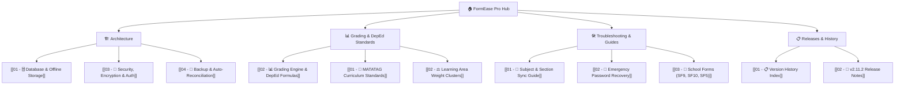

# 🏫 FormEase Pro — Master Knowledge Hub

Welcome to the **FormEase Pro Knowledge Vault**! This vault contains official architectural documentation, DepEd grading standard workflows, troubleshooting guides, and release roadmaps.

---

## 🧭 Navigation Map

### 🏗️ Architecture & Core Systems
* **[[01 - 🗄️ Database & Offline Storage]]** — IndexedDB schema, AES-256-GCM encryption, safeStorage keychains.
* **[[02 - 📊 Grading Engine & DepEd Formulas]]** — Weighted scores, transmutation tables, HPS isolation, and Grade 1 PACE forms.
* **[[03 - 🔐 Security, Encryption & Auth]]** — PBKDF2 hashing, master recovery keys, hardware machine ID binding.
* **[[04 - 🔄 Backup & Auto-Reconciliation]]** — Multi-slot backups, JSON snapshots, and post-update self-healing.

### 📜 DepEd Standards & Regulations
* **[[01 - 📜 MATATAG Curriculum Standards]]** — DepEd Order 2026 compliance, elementary clusters, junior high subjects.
* **[[02 - ⚖️ Learning Area Weight Clusters]]** — Written Works, Performance Tasks, and Quarterly Exams weight configurations.

### 🛠️ Troubleshooting & Support
* **[[01 - 🐞 Subject & Section Sync Guide]]** — Resolving custom subject variants, section normalization, and E-Class dropdowns.
* **[[02 - 🔑 Emergency Password Recovery]]** — 2-step password reset, master key `formease`, and lockout protection.
* **[[03 - 📄 School Forms (SF9, SF10, SF5)]]** — SF9 Learner Progress, SF10 Permanent Record, SF5 Promotion, and SF6 Summaries.

### 📋 Release & Changelogs
* **[[01 - 📋 Version History Index]]** — Complete release timeline and major architectural milestones.
* **[[02 - 🚀 v2.11.2 Release Notes]]** — Subject normalization, E-Class score grid fallback, and bundle optimizations.

---

## ⚡ Quick App Specs
- **Framework**: React 19 + TypeScript + Vite 7
- **Desktop Runtime**: Electron 34 with Node.js 20
- **Database**: IndexedDB (Native `FormEaseDB`, Version 11)
- **Encryption**: AES-256-GCM + PBKDF2 (100,000 iterations)
- **Styling**: Tailwind CSS + Framer Motion
- **Reports**: ExcelJS, jsPDF, PDFKit, Canvas 2D
