# 🏫 FormEase Pro — Master Knowledge Hub

Welcome to the **FormEase Pro Knowledge Vault**! This vault contains official architectural documentation, DepEd grading standard workflows, troubleshooting guides, business models, and DevOps release pipelines.

```mermaid
graph TD
    Hub["🏠 FormEase Pro Hub"] --> Arch["🏗️ Architecture"]
    Hub --> Features["⚡ Features & Engines"]
    Hub --> Grading["📊 DepEd Standards & Forms"]
    Hub --> Biz["💼 Business & Marketing"]
    Hub --> DevOps["🚀 DevOps & QA"]
    Hub --> Guides["🛠️ Troubleshooting & Support"]

    Arch --> DB["[[01 - 🗄️ Database & Offline Storage]]"]
    Arch --> Sec["[[03 - 🔐 Security, Encryption & Auth]]"]
    Arch --> Backup["[[04 - 🔄 Backup & Auto-Reconciliation]]"]
    Arch --> Gate["[[05 - 📱 Mobile Gateway & Local Attendance Sync]]"]
    Arch --> Lic["[[06 - 🔑 License Portal & Activation Cryptography]]"]

    Features --> IDCard["[[05 - 🪪 Student ID Card Generator & Layouts]]"]
    Features --> SMS["[[06 - 📩 SMS Gateway & Parent Notification System]]"]
    Features --> Awards["[[07 - 🎓 Awards Engine & Certificate Generator]]"]
    Features --> Games["[[08 - 🎲 Interactive Classroom Games & Teaching Tools]]"]
    Features --> SF8["[[09 - 🍎 SF8 Nutritional Assessment & BMI Engine]]"]

    Grading --> Engine["[[02 - 📊 Grading Engine & DepEd Formulas]]"]
    Grading --> Matatag["[[01 - 📜 MATATAG Curriculum Standards]]"]
    Grading --> Weights["[[02 - ⚖️ Learning Area Weight Clusters]]"]
    Grading --> SFMaster["[[03 - 📋 DepEd School Forms Master Guide (SF1 to SF10)]]"]

    Biz --> Price["[[01 - 💰 Pricing, Licensing Models & School Tiers]]"]
    Biz --> Pitch["[[02 - 📢 Marketing Copy, Pitch Decks & Demo Scripts]]"]

    DevOps --> Pipeline["[[01 - 🏗️ Build, Packaging & Release Pipeline]]"]
    DevOps --> QA["[[02 - 🧪 Pre-Flight QA & Smoke Testing Checklist]]"]
    DevOps --> Releases["[[01 - 📋 Version History Index]]"]

    Guides --> Sync["[[01 - 🐞 Subject & Section Sync Guide]]"]
    Guides --> Recovery["[[02 - 🔑 Emergency Password Recovery]]"]
    Guides --> Forms["[[03 - 📄 School Forms (SF9, SF10, SF5)]]"]
    Guides --> SF10["[[04 - 📑 SF10 Permanent Record & Historical Transcripts]]"]
```

---

## 🧭 Navigation Map

### 🏗️ Architecture & Core Systems
* **[[01 - 🗄️ Database & Offline Storage]]** — IndexedDB schema, AES-256-GCM encryption, safeStorage keychains.
* **[[02 - 📊 Grading Engine & DepEd Formulas]]** — Weighted scores, transmutation tables, HPS isolation, and Grade 1 PACE forms.
* **[[03 - 🔐 Security, Encryption & Auth]]** — PBKDF2 hashing, master recovery keys, hardware machine ID binding.
* **[[04 - 🔄 Backup & Auto-Reconciliation]]** — Multi-slot backups, JSON snapshots, and post-update self-healing.
* **[[05 - 📱 Mobile Gateway & Local Attendance Sync]]** — Embedded Express LAN microservice (:3001), WebRTC QR scanner.
* **[[06 - 🔑 License Portal & Activation Cryptography]]** — Offline hardware key hashing, obfuscated desktop shields.

### ⚡ Key Features & Engines
* **[[05 - 🪪 Student ID Card Generator & Layouts]]** — DepEd ID card layouts, 300 DPI vector PDF sheets, Code128 barcodes.
* **[[06 - 📩 SMS Gateway & Parent Notification System]]** — Automated parent SMS alerts via GSM modem / Android bridge.
* **[[07 - 🎓 Awards Engine & Certificate Generator]]** — Academic Excellence evaluators, Old English calligraphy diplomas.
* **[[08 - 🎲 Interactive Classroom Games & Teaching Tools]]** — Wheel of Fortune student picker, class timer, team randomizer.
* **[[09 - 🍎 SF8 Nutritional Assessment & BMI Engine]]** — Automated Body Mass Index & Height-for-Age health calculations.

### 📜 DepEd Standards & Forms Encyclopedia
* **[[01 - 📜 MATATAG Curriculum Standards]]** — DepEd Order 2026 compliance, elementary clusters, junior high subjects.
* **[[02 - ⚖️ Learning Area Weight Clusters]]** — Written Works, Performance Tasks, and Quarterly Exams weight configurations.
* **[[03 - 📋 DepEd School Forms Master Guide (SF1 to SF10)]]** — Master overview of all standard DepEd school forms.

### 💼 Business, Pricing & Sales Kit
* **[[01 - 💰 Pricing, Licensing Models & School Tiers]]** — Solo Teacher, Grade-Level bundle, and School Site licensing models.
* **[[02 - 📢 Marketing Copy, Pitch Decks & Demo Scripts]]** — High-converting pitch scripts and value propositions for school heads.

### 🚀 DevOps, QA & Releases
* **[[01 - 🏗️ Build, Packaging & Release Pipeline]]** — Production packaging, Electron obfuscation, and update distribution.
* **[[02 - 🧪 Pre-Flight QA & Smoke Testing Checklist]]** — Pre-release test checklist to ensure zero data regressions.
* **[[01 - 📋 Version History Index]]** — Complete release timeline and major architectural milestones.
* **[[02 - 🚀 v2.11.2 Release Notes]]** — Subject normalization, E-Class score grid fallback, and bundle optimizations.

### 🛠️ Troubleshooting & Guides
* **[[01 - 🐞 Subject & Section Sync Guide]]** — Resolving custom subject variants, section normalization, and E-Class dropdowns.
* **[[02 - 🔑 Emergency Password Recovery]]** — 2-step password reset, master key `formease`, and lockout protection.
* **[[03 - 📄 School Forms (SF9, SF10, SF5)]]** — SF9 Learner Progress, SF10 Permanent Record, SF5 Promotion, and SF6 Summaries.
* **[[04 - 📑 SF10 Permanent Record & Historical Transcripts]]** — Multi-year scholastic transcript generation and eligibility clearance.

---

## ⚡ Quick App Specs
- **Framework**: React 19 + TypeScript + Vite 7
- **Desktop Runtime**: Electron 34 with Node.js 20
- **Database**: IndexedDB (Native `FormEaseDB`, Version 11)
- **Encryption**: AES-256-GCM + PBKDF2 (100,000 iterations)
- **Styling**: Tailwind CSS + Framer Motion
- **Reports**: ExcelJS, jsPDF, PDFKit, Canvas 2D
