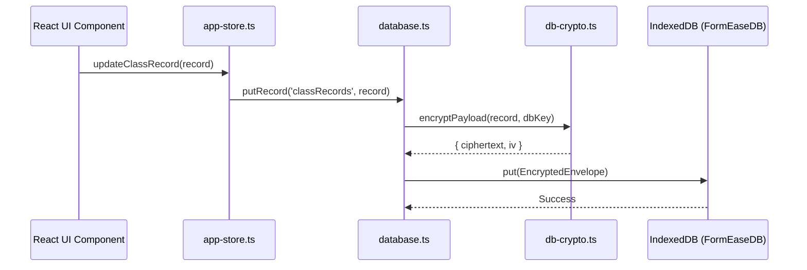

# 🗄️ Database & Offline Storage Architecture

FormEase Pro operates on a **100% offline-first architecture** powered by browser-native IndexedDB and Web Crypto AES-256-GCM.

---

## 🏗️ Core Database Properties
- **Database Name**: `FormEaseDB`
- **Database Version**: `11`
- **Primary Service**: `app/src/services/database.ts`
- **Store Keys**:
  - `students`: Keyed by `lrn` (12-digit DepEd Learner Reference Number)
  - `sections`: Keyed by `id` (e.g. `section_172...`)
  - `subjects`: Keyed by `id` (e.g. `subject_172...`)
  - `classRecords`: Keyed by `id` (e.g. `grade_{lrn}_{subjectId}_Q{quarter}`)
  - `hpsRecords`: Keyed by `id` (e.g. `hps_{sectionId}_{subjectId}_{SY}_Q{quarter}`)
  - `gradingSheetRecords`: Keyed by `id` (e.g. `{lrn}_{subjectId}_{quarter}_{SY}`)
  - `attendanceRecords`: Keyed by `id`
  - `sf2Sheets`: Keyed by `id`
  - `observedValues`: Keyed by `id`
  - `schoolProfile`: Keyed by `school_id`

---

## 🔐 Encrypted Envelope Pattern

Sensitive student data tables are encrypted at rest using AES-256-GCM. When stored in IndexedDB, the records are wrapped in an `EncryptedEnvelope`:

```typescript
interface EncryptedEnvelope {
  id?: string;
  lrn?: string;
  iv: string;           // Base64-encoded 12-byte initialization vector
  ciphertext: string;   // Base64-encoded encrypted JSON string
  is_encrypted: boolean;
  
  // Projected plain-text index fields for fast querying
  student_lrn?: string;
  subject_id?: string;
  school_year?: string;
}
```



---

## ⚡ Self-Healing & Startup Hydration
On application startup (`initializeAppStore`):
1. Loads all stores concurrently via `Promise.all`.
2. Decrypts records using the active session key.
3. Automatically backfills missing `subject_name` attributes on legacy records to maintain seamless link with standard DepEd subject templates.

See also:
- [[02 - 📊 Grading Engine & DepEd Formulas]]
- [[03 - 🔐 Security, Encryption & Auth]]
- [[04 - 🔄 Backup & Auto-Reconciliation]]
