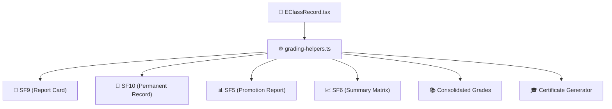

# 📊 Grading Engine & DepEd Formulas

FormEase Pro implements the official **DepEd Classroom Assessment Guidelines** (DepEd Order No. 8, s. 2015 / DepEd Order No. 2026 update).

---

## 🧮 Assessment Components & Weights

Every quarterly grade consists of three fundamental weighted components:
1. **Written Works (WW)**
2. **Performance Tasks (PT)**
3. **Quarterly Assessment / Exams (QA)**

$$\text{Initial Grade} = (\text{WW WS}) + (\text{PT WS}) + (\text{QA WS})$$

Where:
- $\text{Total Score} = \sum \text{Score}_i$
- $\text{Percentage Score (PS)} = \frac{\text{Total Score}}{\text{Total HPS}} \times 100$
- $\text{Weighted Score (WS)} = \text{PS} \times \text{Weight Factor}$

---

## ⚖️ Standard Learning Area Weights

| Learning Area | Written Works | Performance Tasks | Quarterly Exam |
| :--- | :---: | :---: | :---: |
| **Languages, AP, ESP / Values** | 30% | 50% | 20% |
| **Science, Mathematics** | 40% | 40% | 20% |
| **MAPEH, EPP / TLE** | 20% | 60% | 20% |
| **Senior High (Core Subjects)** | 25% | 50% | 25% |
| **Senior High (TVL / Immersion)** | 20% | 60% | 20% |

---

## 📈 DepEd Transmutation Table (SY 2026-2027)

Initial grades (0–100) are mapped to Transmuted Quarterly Grades (60–100):

| Initial Score Range | Transmuted Grade | Descriptors |
| :---: | :---: | :---: |
| **100** | 100 | Outstanding |
| **98.40 – 99.99** | 99 | Outstanding |
| **96.80 – 98.39** | 98 | Outstanding |
| **95.20 – 96.79** | 97 | Outstanding |
| **93.60 – 95.19** | 96 | Outstanding |
| **92.00 – 93.59** | 95 | Outstanding |
| **90.40 – 91.99** | 94 | Outstanding |
| **88.80 – 90.39** | 93 | Outstanding |
| **87.20 – 88.79** | 92 | Very Satisfactory |
| **85.60 – 87.19** | 91 | Very Satisfactory |
| **84.00 – 85.59** | 90 | Very Satisfactory |
| **82.40 – 83.99** | 89 | Satisfactory |
| **80.80 – 82.39** | 88 | Satisfactory |
| **79.20 – 80.79** | 87 | Satisfactory |
| **77.60 – 79.19** | 86 | Satisfactory |
| **76.00 – 77.59** | 85 | Satisfactory |
| **74.40 – 75.99** | 84 | Fairly Satisfactory |
| **72.80 – 74.39** | 83 | Fairly Satisfactory |
| **71.20 – 72.79** | 82 | Fairly Satisfactory |
| **69.60 – 71.19** | 81 | Fairly Satisfactory |
| **68.00 – 69.59** | 80 | Fairly Satisfactory |
| **66.40 – 67.99** | 79 | Did Not Meet Expectations |
| **64.80 – 66.39** | 78 | Did Not Meet Expectations |
| **63.20 – 64.79** | 77 | Did Not Meet Expectations |
| **61.60 – 63.19** | 76 | Did Not Meet Expectations |
| **60.00 – 61.59** | 75 | Passing Threshold |
| **Below 60.00** | Transmuted (60–74) | Did Not Meet Expectations |

---

## 🎯 Multi-Module Synchronization Architecture

All downstream modules consume the single source of truth via `app/src/utils/grading-helpers.ts`:

See also:
- [[01 - 🗄️ Database & Offline Storage]]
- [[02 - ⚖️ Learning Area Weight Clusters]]
