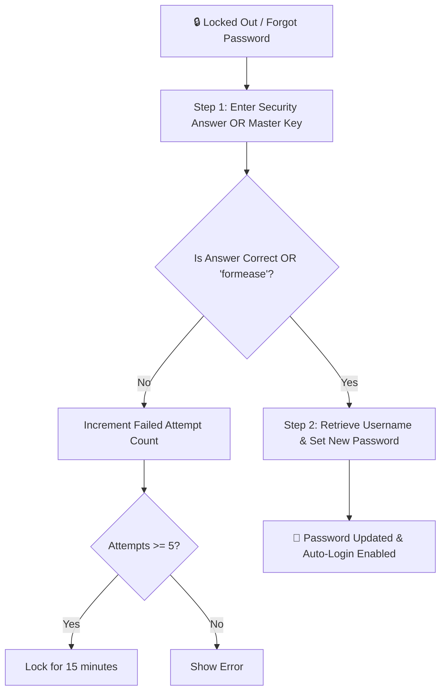

# 🔐 Security, Encryption & Authentication

FormEase Pro uses a multi-layered offline security architecture to safeguard teacher credentials, licensing status, and student records.

---

## 🔑 Authentication Store (`auth-store.ts`)

- **Password Storage**: PBKDF2 with SHA-256 (100,000 iterations + 32-byte salt). Passwords are **never stored in plaintext**.
- **Session Duration**: 12 hours active memory session.
- **Storage Keys**:
  - `formease-credentials-v2`: Stored username, hashed password, and security answer hash.
  - `formease-recovery-attempts`: Tracks failed recovery attempts and lockouts.

---

## 🛡️ 2-Step Emergency Password Recovery

To ensure teachers never lose access to their student data if they forget their password:

### Master Emergency Key
- Master Key: `formease` or `formeasepro`
- Allows instant authorization in Step 1 to retrieve the forgotten username and assign a fresh password.

---

## 💻 Hardware Machine ID Binding

On desktop (Electron), hardware identification is derived from:
- CPU serial number
- Motherboard UUID
- Primary network adapter MAC address

The machine ID is hashed with SHA-256 before interacting with cloud licensing or trial registries, ensuring device privacy.

See also:
- [[01 - 🗄️ Database & Offline Storage]]
- [[02 - 🔑 Emergency Password Recovery]]
