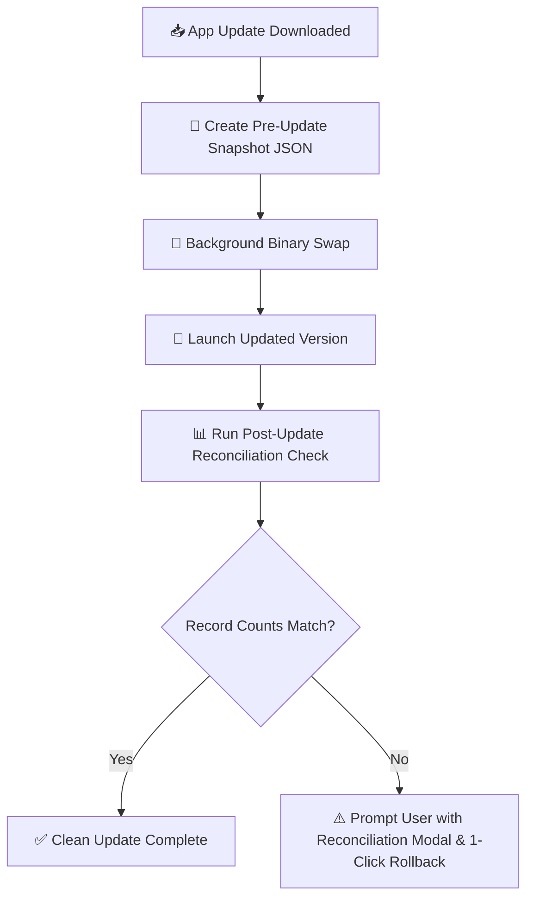

# 🔄 Backup & Auto-Reconciliation Architecture

FormEase Pro employs a triple-redundant data safety system to prevent any loss of grades, student rosters, or section settings during updates, reboots, or hardware migrations.

---

## 🗂️ Triple Redundancy Backup System

1. **Automatic Daily Snapshots (`AutoBackupManager.ts`)**:
   - Stores up to 10 automated rolling snapshot archives inside IndexedDB (`automated_backups` store).
   - Rotating snapshot retention: automatically trims older backups when the slot limit is reached.

2. **Incremental Change Tracking (`IncrementalBackupService.ts`)**:
   - Tracks realtime delta writes for emergency recovery during unexpected power cuts or system restarts.

3. **Pre-Update Snapshot & Post-Update Reconciliation (`update-store.ts`)**:
   - Before executing any application update, Electron creates an off-site filesystem backup snapshot (`formease-pre-update-backup-*.json`).
   - Upon relaunch, `checkForPostUpdateReconciliation()` compares store record counts before vs after the update.
   - If a mismatch is detected, a 1-click **Rollback to Pre-Update State** button is presented to the user.



---

## 📦 Export / Import JSON Data Structure

Exported JSON backup archives contain full raw store tables:
```json
{
  "version": 11,
  "app_version": "2.11.2",
  "exported_at": "2026-08-17T10:55:00.000Z",
  "school_profile": { ... },
  "payload": {
    "students": [ ... ],
    "sections": [ ... ],
    "subjects": [ ... ],
    "classRecords": [ ... ],
    "hpsRecords": [ ... ],
    "gradingSheetRecords": [ ... ],
    "enrollments": [ ... ],
    "attendanceRecords": [ ... ],
    "sf2Sheets": [ ... ],
    "observedValues": [ ... ]
  }
}
```

See also:
- [[01 - 🗄️ Database & Offline Storage]]
- [[01 - 🐞 Subject & Section Sync Guide]]
