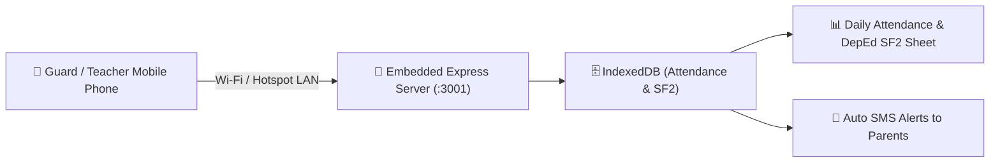

# 📱 Mobile Attendance Gateway & QR Scanner

FormEase Pro includes a **built-in local LAN web server** that allows teachers and gate guards to scan student ID QR codes or barcodes using their mobile phones without needing an internet connection.

---

## ⚡ Key Technical Capabilities

1. **Zero-Internet Local Network Sync**:
   - Electron launches a background Express microservice on port `3001` (`server.js`).
   - The desktop app displays a QR code containing the local Wi-Fi IP address (e.g. `http://192.168.1.15:3001`).
   - Any phone connected to the same Wi-Fi or mobile hotspot can open the mobile scanner web app instantly.

2. **Ultra-Fast Camera Scanning (`jsqr` & WebRTC)**:
   - Scans 12-digit DepEd LRN barcodes or QR codes in less than 100ms.
   - Audible voice feedback ("Good morning!", "Time in recorded").

3. **Direct SF2 Attendance Ledger Logging**:
   - Automatically computes monthly Days Present, Days Absent, and Tardy counts for DepEd School Form 2 (SF2).

See also:
- [[01 - 🗄️ Database & Offline Storage]]
- [[03 - 📄 School Forms (SF9, SF10, SF5)]]
- [[06 - 📩 SMS Gateway & Parent Notification System]]
- [[05 - 🪪 Student ID Card Generator & Layouts]]
