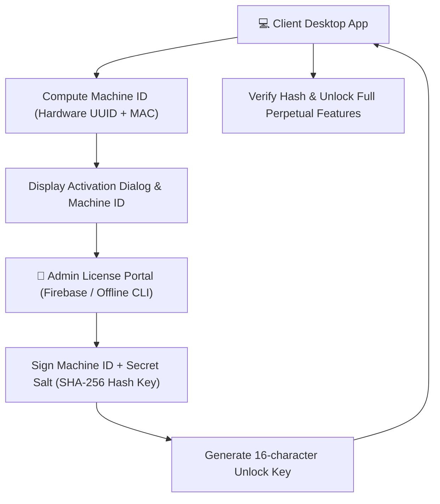

# 🔑 License Portal & Activation Cryptography

FormEase Pro operates with an **offline-capable hardware activation model** allowing schools without consistent internet to register and activate software licenses locally.

---

## 🔒 Activation Flow & Cryptographic Proof

---

## 🛡️ License Protection Shield
- **Obfuscation**: Electron production entrypoints (`dist-electron/main.cjs`, `license.cjs`, `preload.cjs`) are shielded with JS Obfuscator control flow flattening and string encryption.
- **Hardware Binding**: Unlock keys cannot be cloned to other laptops or PCs because each unlock key is tied to that specific device's CPU and motherboard signature.

See also:
- [[03 - 🔐 Security, Encryption & Auth]]
- [[01 - 🗄️ Database & Offline Storage]]
