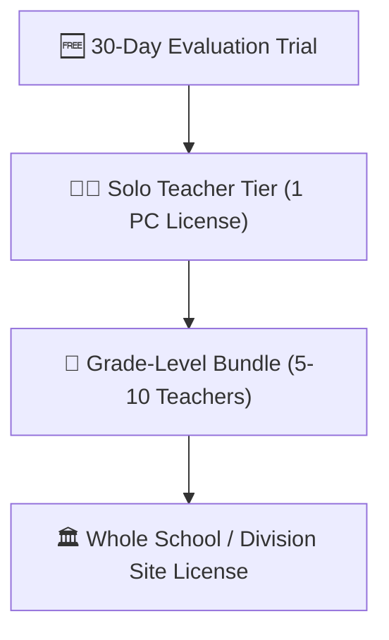

# 💰 Pricing, Licensing Models & School Tiers

Strategic pricing tiers and license distribution models for FormEase Pro.

---

## 🏷️ Standard Product Tier Breakdown

| Package Tier | Target Audience | Target Price (PHP) | License Terms | Key Inclusions |
| :--- | :--- | :---: | :--- | :--- |
| **Solo Teacher** | Individual Class Advisers / Subject Teachers | **₱499 – ₱799** | Perpetual (Single Device) | E-Class Record, SF9, SF10, Student ID Maker |
| **Grade-Level Bundle** | 6–10 Advisers in the same Grade Level | **₱2,499 – ₱3,999** | 10 Device Activations | Multi-user bundle, Consolidated Grades Matrix |
| **School Site License** | Whole Elementary or High School | **₱7,999 – ₱14,999** | Unlimited Campus Devices | Master Admin Dashboard, SMS Gateway, Priority Updates |
| **Division Rollout** | DepEd School Division Offices (SDO) | **Custom Enterprise** | SDO Perpetual Contract | Bulk onboarding, custom regional DepEd templates |

---

## 🔒 Offline Hardware Key Distribution
- **Zero Cloud Dependence**: Licenses are cryptographically bound to hardware Machine IDs (`node-machine-id`) and unlocked via 16-character offline keys.
- **Trial-to-Full Transition**: Seamlessly preserves all entered student grades and section configurations when transitioning from trial to activated status.

See also:
- [[06 - 🔑 License Portal & Activation Cryptography]]
- [[02 - 📢 Marketing Copy, Pitch Decks & Demo Scripts]]
