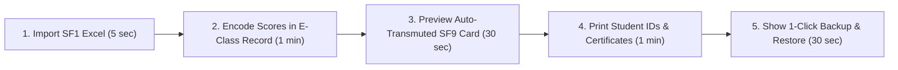

# 📢 Marketing Copy, Pitch Decks & Demo Scripts

High-impact pitch scripts and benefit-focused marketing copy for presenting FormEase Pro to School Principals, Master Teachers, and PTA Boards.

---

## 🎯 The 30-Second Elevator Pitch

> *"FormEase Pro is an all-in-one, 100% offline DepEd School Management & Grading System designed specifically for Filipino teachers. It automates E-Class Records, MATATAG 2026 transmutations, SF9 report cards, and SF10 permanent records in one click—cutting grading paperwork from 30 hours a quarter down to under 15 minutes, with zero monthly cloud fees and 100% student data privacy."*

---

## 🌟 Top 5 Value Propositions for School Leaders

1. **100% DepEd MATATAG 2026 Ready**:
   - Built-in compliance with DepEd Order 2026 guidelines, Academic Excellence Awards, and Grade 1 PACE reporting layouts.
2. **Zero Internet Required**:
   - Works seamlessly in remote barangays and offline classrooms without server downtime or internet data costs.
3. **Ironclad Student Privacy (Data Privacy Act of 2012)**:
   - Sensitive learner records are encrypted locally on the school PC (AES-256-GCM)—never uploaded to vulnerable third-party servers.
4. **Complete School Forms Suite (SF1 to SF10)**:
   - Eliminates tedious manual copy-pasting into multiple Excel files.
5. **Integrated Gate Scanner & Parent SMS**:
   - Scans student QR badges at the school gate and sends automated SMS alerts to parents in real-time.

---

## 🎤 5-Minute Live School Demo Flow

See also:
- [[01 - 💰 Pricing, Licensing Models & School Tiers]]
- [[03 - 📋 DepEd School Forms Master Guide (SF1 to SF10)]]
