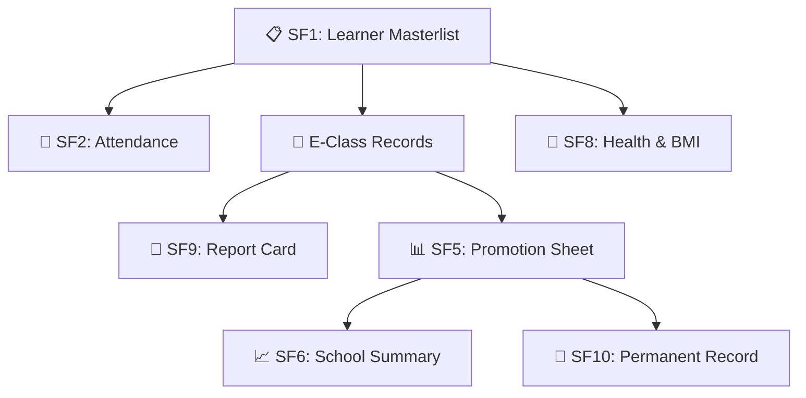

# 📋 DepEd School Forms Master Guide (SF1 to SF10)

The comprehensive encyclopedia of Department of Education standard school forms automated by FormEase Pro.

---

## 📑 Complete DepEd School Forms Matrix

| Form Code | Official Name | Frequency | Target Role | Automated in FormEase Pro |
| :---: | :--- | :---: | :---: | :---: |
| **SF1** | **School Register** | Beginning of School Year (BOSY) | Class Adviser | ✅ 1-Click Excel / CSV Import & Parser |
| **SF2** | **Daily Attendance Report** | Monthly | Class Adviser | ✅ Realtime QR Scanner & Excel `.xls` Generation |
| **SF3** | **Books Issued and Returned** | BOSY / EOSY | Property Custodian | 🔄 Planned (Module Roadmap) |
| **SF4** | **Monthly Learner Movement & Summary** | Monthly | School Head / Registrar | ✅ Auto-Aggregated from SF2 Attendance Data |
| **SF5** | **Report on Promotion & Proficiency** | End of School Year (EOSY) | Class Adviser | ✅ Official DepEd `.xlsx` Multi-Tab Export |
| **SF5K**| **Kindergarten Promotion Report** | EOSY | Kinder Adviser | ✅ Early Childhood Competency Evaluation |
| **SF6** | **Summarized Report on Promotion** | EOSY | School Head / Principal | ✅ School-Wide Level of Proficiency Matrix |
| **SF7** | **School Personnel Assignment** | Annual | School Head | 🔄 Planned (Staff Registry Module) |
| **SF8** | **Learner's Basic Health & Nutritional Status**| BOSY / EOSY | MAPEH / Clinic | ✅ Automated BMI & Height-for-Age (HFA) Classifier |
| **SF9** | **Learner Progress Report Card** | Quarterly | Class Adviser | ✅ Printable Front & Back Cards (DepEd / MATATAG / PACE) |
| **SF10**| **Learner's Permanent Academic Record (Form 137)**| As Needed / Transferees | Guidance / Registrar | ✅ Multi-Year Scholastic Transcript & Clearance |

---

## 🔄 Cross-Form Data Pipeline

See also:
- [[01 - 📜 MATATAG Curriculum Standards]]
- [[02 - 📊 Grading Engine & DepEd Formulas]]
- [[04 - 📑 SF10 Permanent Record & Historical Transcripts]]
