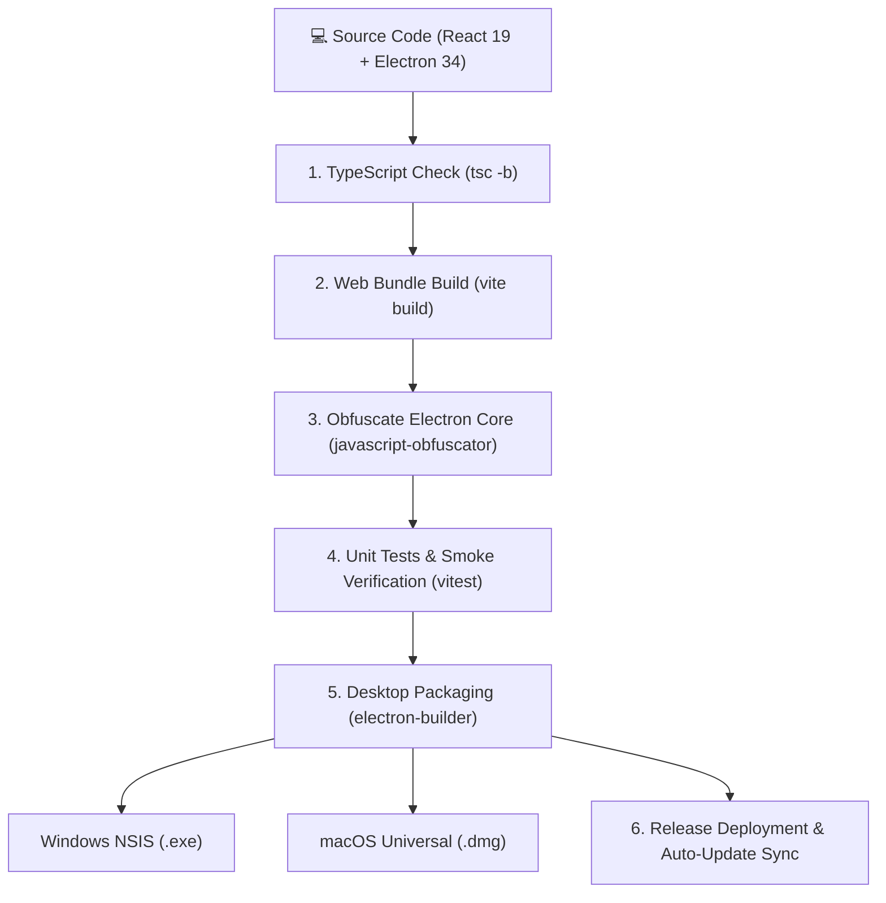

# 🏗️ Build, Packaging & Release Pipeline

The official automated workflow for compiling, obfuscating, verifying, and publishing FormEase Pro desktop and web releases.

---

## 🚀 Production Build Sequence



---

## 🛠️ CLI Release Command Cheat Sheet

```bash
# 1. Verify and test codebase
npm run test

# 2. Compile Web App & Obfuscate Desktop Entrypoints
npm run build && npm run obfuscate:electron

# 3. Pre-flight integrity audit
npm run release:check

# 4. Package Windows Installer (x64 / ia32)
npm run electron:build:win

# 5. Package macOS Universal Bundle
npm run electron:build:mac
```

---

## 🛡️ Security Obfuscation Shields (`scripts/obfuscate-electron.cjs`)
To safeguard intellectual property and licensing logic:
- Transforms `electron/main.cjs`, `license.cjs`, and `preload.cjs` into high-entropy control flow flattened code.
- Strips debug strings and console traces in production builds.

See also:
- [[02 - 🧪 Pre-Flight QA & Smoke Testing Checklist]]
- [[06 - 🔑 License Portal & Activation Cryptography]]
- [[01 - 📋 Version History Index]]
