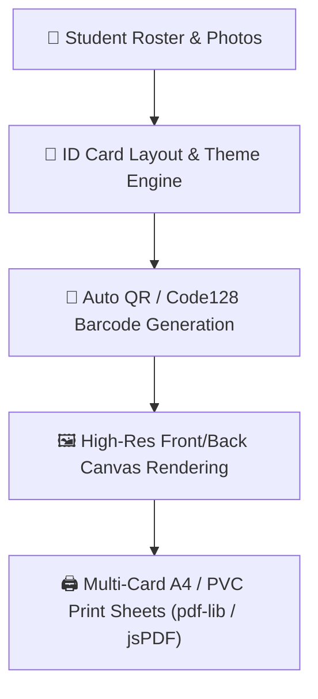

# 🪪 Student ID Card Generator & Template Engine

FormEase Pro features a built-in **Printable Student ID Generator** (`StudentIDGeneratorPage.tsx`) tailored for DepEd school requirements.

---

## 🎨 Supported Design Presets

| Template Preset | Orientation | Best For | Features |
| :--- | :---: | :--- | :--- |
| **Standard DepEd** | Vertical | Elementary & JHS | DepEd header seal, learner photo, emergency contact |
| **Lanyard Modern** | Vertical | Junior & Senior High | Bold student name, color-coded strand badge, QR code |
| **Corporate Glass** | Vertical / Horiz | Teachers & Staff | Glassmorphism acrylic gradient, high-res signature |
| **Minimalist Clean** | Vertical | High-speed mass printing | Low ink consumption, crisp high-contrast text |
| **Aurora Glow** | Vertical | Senior High & College | Premium modern neon accents, custom school emblem |

---

## 🖨️ Production Printing Specs
- **Supported Media**: PVC Card Printers (CR80 standard), Glossy Photo Paper (A4 8-card sheets)
- **Barcodes**: Code 128 (encodes 12-digit DepEd LRN)
- **Resolution**: 300 DPI vector output

See also:
- [[05 - 📱 Mobile Gateway & Local Attendance Sync]]
- [[01 - 🗄️ Database & Offline Storage]]
