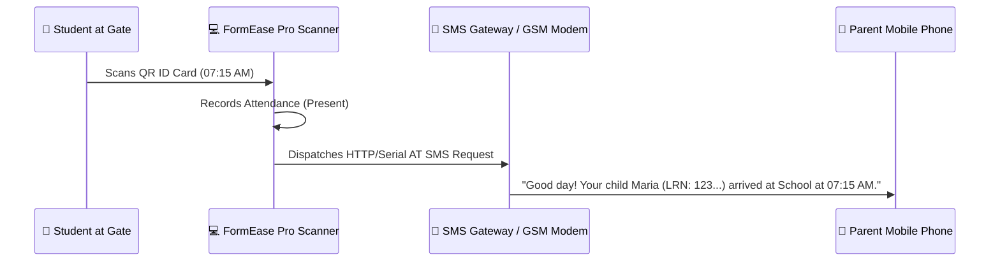

# 📩 SMS Gateway & Parent Notification System

FormEase Pro integrates with local GSM hardware modems and Android SMS gateways to send automated text alerts to parents upon student time-in, time-out, or grade release.

---

## ⚡ Workflow & Notification Triggers

---

## 🛠️ Supported Gateway Modes (`SmsGatewaySettings.tsx`)
1. **Local Android Phone Gateway**: Uses local Wi-Fi API (e.g. Termux SMS bridge or local HTTP gateway app).
2. **USB GSM / SIM800 Modem**: Communicates via serial COM port using standard AT commands.
3. **Cloud SMS Provider (Optional)**: Supports Semaphore, Twilio, or iTexMo API keys when internet is available.

See also:
- [[05 - 📱 Mobile Gateway & Local Attendance Sync]]
- [[05 - 🪪 Student ID Card Generator & Layouts]]
