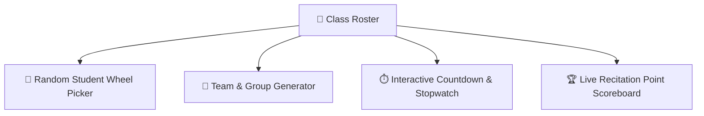

# 🎲 Interactive Classroom Games & Teaching Tools

FormEase Pro integrates dynamic digital classroom engagement utilities (`GamesAndToolsPage.tsx`) to make daily recitations and group activities fun and interactive.

---

## 🎮 Suite of Interactive Tools

1. **🎡 Wheel of Fortune (Random Student Picker)**:
   - Visual spinning wheel loaded with current section learners.
   - Eliminates bias during graded oral recitations.
   - Festive celebratory animations and sound effects upon selection.

2. **🧩 Team & Group Randomizer**:
   - Generates balanced student clusters (e.g. 4 teams of 5 learners) balanced by gender or academic performance.

3. **⏱️ Big-Screen Classroom Timer**:
   - High-contrast countdown timer for quizzes, debates, and board activities.

4. **🏆 Realtime Points Scoreboard**:
   - Keeps track of team scores during classroom games and quizzes.

See also:
- [[05 - 🪪 Student ID Card Generator & Layouts]]
- [[00 - 🏠 FormEase Pro Hub]]
