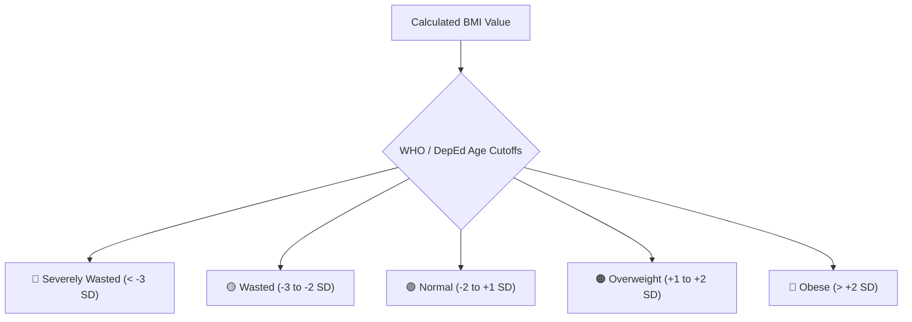

# 🍎 SF8 Nutritional Assessment & BMI Engine

FormEase Pro automates the computation and categorization of student Body Mass Index (BMI) and Height-for-Age (HFA) for DepEd School Form 8 (`SF8Page.tsx`).

---

## 🧮 Standard Mathematical Formulations

$$\text{BMI} = \frac{\text{Weight (kg)}}{(\text{Height (m)})^2}$$

$$\text{Height-for-Age (HFA)} = \text{Height (cm)} \text{ compared against WHO Child Growth Standards by Age \& Gender}$$

---

## 📊 DepEd Nutritional Status Categories

### Height-for-Age (HFA) Classifications
- **Severely Stunted**
- **Stunted**
- **Normal**
- **Tall**

---

## 🖨️ SF8 Summary Features
- **Feeding Program Beneficiary Flagging**: Automatically flags *Severely Wasted* and *Wasted* learners for the School-Based Feeding Program (SBFP).
- **BOSY vs EOSY Tracking**: Records baseline measurements at the Beginning of the School Year (BOSY) and compares improvement at the End of the School Year (EOSY).

See also:
- [[03 - 📋 DepEd School Forms Master Guide (SF1 to SF10)]]
- [[01 - 🗄️ Database & Offline Storage]]
