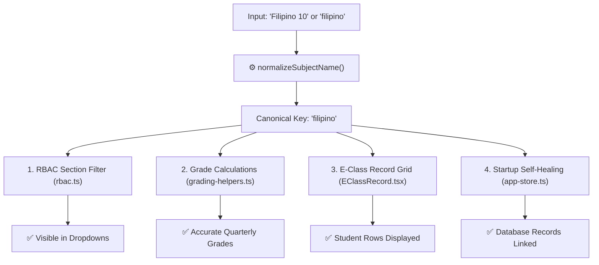

# 🐞 Subject & Section Sync Guide

This guide explains how FormEase Pro normalizes custom subject names and ensures section configurations seamlessly display in E-Class Records and SF9.

---

## 🔍 The Root Problem (Custom Subject Suffixes)

In older versions or manual subject configurations:
- Teachers frequently entered subjects with grade numbers (e.g. `Filipino 10`, `Math 7`, `Science 8`).
- Standard DepEd templates use canonical names (e.g. `Filipino`, `Mathematics`, `Science`).
- If a section's `taught_subjects` contained `["Filipino 10"]` while the active subject in the Subject Hub was `Filipino`, rigid string matching (`registeredNames.has(s.subject_name)`) caused the subject to be hidden from dropdowns.

---

## 🛠️ The Comprehensive Solution (v2.11.2 / v2.11.3)

### 1. Robust Normalization Engine (`subjectConfig.ts`)
Strips whitespace, special characters, and trailing grade numbers while preserving valid numbered Senior High tracks (e.g. `Biology 1`, `General Chemistry 2`).

### 2. Multi-Match Section Filter (`rbac.ts`)
Matches section subjects across:
- Exact string name
- Normalized subject name
- Automatic fallback: if all subjects are filtered out, it returns all active subjects for that grade level so teachers never experience an empty dropdown.

### 3. Startup Self-Healing (`app-store.ts`)
On every app boot, `initializeAppStore` backfills any missing `subject_name` attributes on `classRecords` and `hpsRecords` directly from the active subject catalog.

---

## 🧑‍🏫 Teacher Recovery Checklist (If Subjects Disappear)

If a teacher reports a subject is missing from E-Class Record:
1. Open **Sections** from the main sidebar.
2. Click **Edit** on the section (e.g. *Grade 10 - Mercury*).
3. Ensure the subject checkbox (e.g. **Filipino**) is checked under **Taught Subjects**.
4. Click **Save Section**.
5. Return to **E-Class Record** — the subject and all previously entered grades will appear immediately.

See also:
- [[02 - 📊 Grading Engine & DepEd Formulas]]
- [[02 - 🚀 v2.11.2 Release Notes]]
