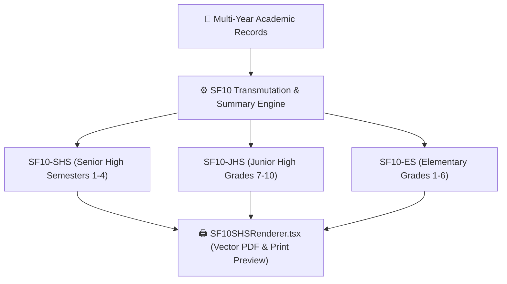

# 📑 SF10 Permanent Record & Historical Transcripts

FormEase Pro provides an automated multi-grade **DepEd Form 137 / School Form 10 (SF10)** generator supporting Elementary (SF10-ES), Junior High (SF10-JHS), and Senior High School (SF10-SHS).

---

## 🏛️ SF10 Architecture & Multi-Year Aggregation

---

## 📋 Standard DepEd SF10 Sections
1. **Learner's Information**: LRN, Full Name, Birthdate, Gender, School Name & ID.
2. **Eligibility Verification**: Elementary Completer / PEPT Passer / ALS Completer checkboxes.
3. **Scholastic Records (Table per Grade/Semester)**:
   - Learning Areas, Quarter Ratings (Q1–Q4), Final Rating, Remarks (Passed/Failed).
   - General Average for the School Year.
4. **Certification of Transfer / Records Clearance**: Head Teacher / Registrar signatures and official school seal block.

See also:
- [[03 - 📄 School Forms (SF9, SF10, SF5)]]
- [[02 - 📊 Grading Engine & DepEd Formulas]]
- [[07 - 🎓 Awards Engine & Certificate Generator]]
